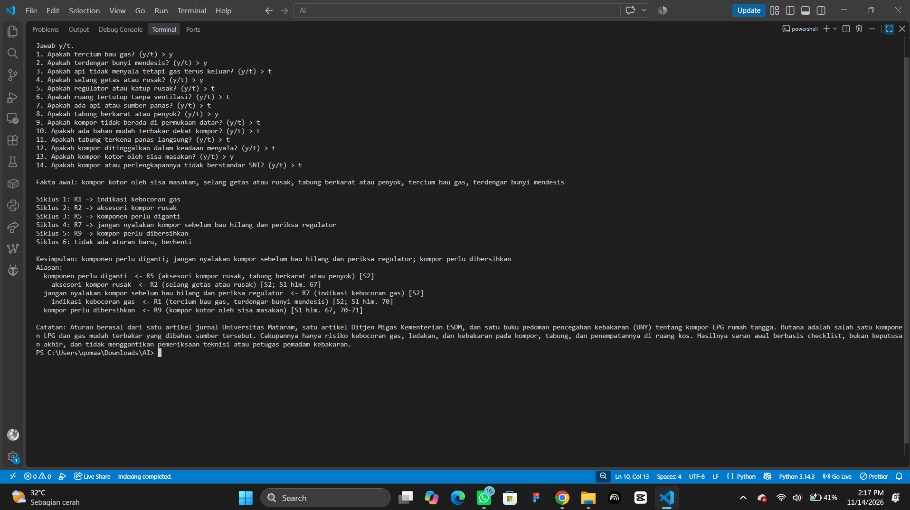
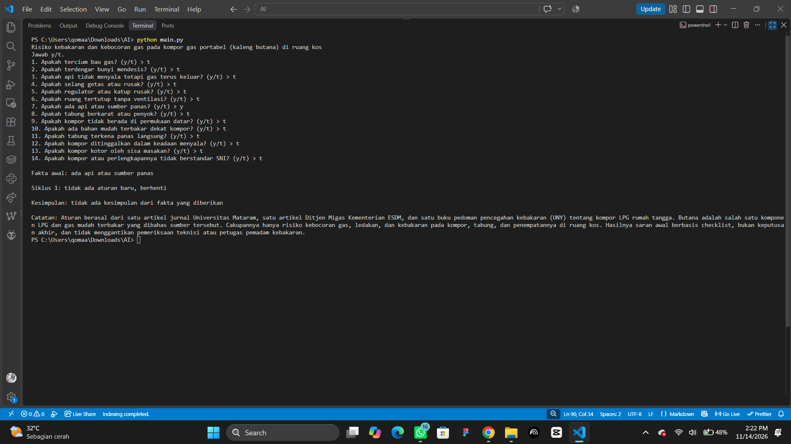
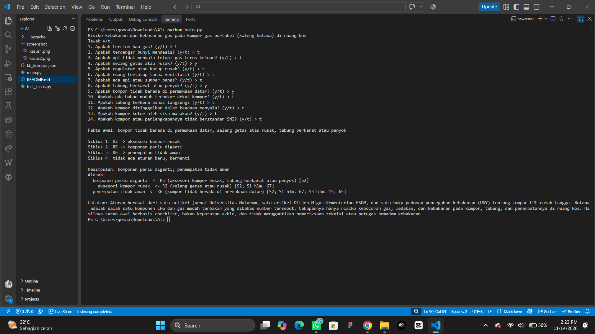

# Sistem Pakar Risiko Kompor Gas Portabel (Kaleng Butana)

**Nama:** Qomari Auliyah
**NIM:** F1D02410086
**Mata kuliah:** Kecerdasan Buatan (MKL1303131), Teknik Informatika, Universitas Mataram

## Topik dan Cara Menjalankan

Topik: **risiko kebocoran gas, ledakan, dan kebakaran pada kompor gas portabel berkaleng butana yang dipakai di ruang kos**. Pengguna menjawab pertanyaan ya atau tidak, lalu program menyimpulkan risiko beserta aturan yang dipakai.

- Bahasa: Python 3.14.3 (tanpa library tambahan)
- Menjalankan program: `python main.py`
- Mode uji tanpa tanya jawab: `python main.py --ya 1,2,4,8,13` (angka adalah nomor pertanyaan, contoh ini sama dengan kasus uji 1)

## Sumber

| Kode | Judul | Penerbit | URL | Diakses |
|---|---|---|---|---|
| S1 | Pelatihan Perawatan Kompor LPG Rumah Tangga untuk Pencegahan Bahaya Kebakaran (Mara dkk., Jurnal Karya Pengabdian Vol. 5 No. 2, 2023) | Universitas Mataram | https://jkp.unram.ac.id/index.php/JKP/article/download/159/175/790 | 14 Nov 2026 |
| S2 | Hindari Kecelakaan Saat Memasak, Jangan Lupa Periksa Selang dan Regulator LPG | Ditjen Migas, Kementerian ESDM | https://migas.esdm.go.id/post/hindari-kecelakaan-saat-memasak-jangan-lupa-periksa-selang-dan-regulator-lpg | 14 Nov 2026 |
| S3 | Buku Pedoman Pencegahan Kebakaran (Ismara dkk., ISBN 978-623-129-543-9, 2025) | CV Bintang Semesta Media | https://k3.uny.ac.id/sites/k3.uny.ac.id/files/%5BE-BOOK%20FC%5D%20BUKU%20PEDOMAN%20PENCEGAHAN%20KEBAKARAN.pdf | 14 Nov 2026 |

## 1. Aturan IF-THEN

Hubungan sebab-akibat dari ketiga sumber ditulis sebagai tabel aturan berikut. Aturan R3 memakai hasil R1, R4 memakai hasil R3, serta R5 dan R7 memakai hasil aturan sebelumnya, sehingga rantai terpanjang adalah R1, R3, R4.

| **Aturan** | **IF** | **THEN** | **Sumber** |
| :--- | :--- | :--- | :--- |
| **R1** | IF tercium bau gas **OR** terdengar bunyi mendesis **OR** api tidak menyala tetapi gas terus keluar | THEN indikasi kebocoran gas | S2; S1 hlm. 70 |
| **R2** | IF selang getas atau rusak **OR** regulator atau katup rusak | THEN aksesori kompor rusak | S2; S1 hlm. 67 |
| **R3** | IF indikasi kebocoran gas **AND** ruang tertutup tanpa ventilasi | THEN gas terakumulasi | S1 hlm. 67; S3 hlm. 20 |
| **R4** | IF gas terakumulasi **AND** ada api atau sumber panas | THEN risiko ledakan atau kebakaran tinggi | S1 hlm. 67, 70; S3 hlm. 16-17, 27 |
| **R5** | IF aksesori kompor rusak **OR** tabung berkarat atau penyok | THEN komponen perlu diganti | S2 |
| **R6** | IF kompor tidak di permukaan datar **OR** ada bahan mudah terbakar dekat kompor **OR** tabung terkena panas langsung | THEN penempatan tidak aman | S2; S1 hlm. 67; S3 hlm. 15, 65 |
| **R7** | IF indikasi kebocoran gas | THEN jangan nyalakan kompor sebelum bau hilang dan periksa regulator | S2 |
| **R8** | IF kompor ditinggalkan dalam keadaan menyala | THEN kompor harus dimatikan setelah selesai dipakai | S1 hlm. 70; S3 hlm. 5, 64 |
| **R9** | IF kompor kotor oleh sisa masakan | THEN kompor perlu dibersihkan | S1 hlm. 67, 70-71 |
| **R10** | IF kompor atau perlengkapannya tidak berstandar SNI | THEN ganti dengan perlengkapan berstandar SNI | S2; S1 hlm. 71 |

Kesimpulan akhir ada tujuh: risiko ledakan atau kebakaran tinggi, komponen perlu diganti, penempatan tidak aman, jangan nyalakan kompor sebelum bau hilang dan periksa regulator, kompor harus dimatikan setelah selesai dipakai, kompor perlu dibersihkan, dan ganti dengan perlengkapan berstandar SNI.

## 2. File Aturan

Aturan disimpan di `kb_kompor.json`. Isian `mode` berupa `"dan"` (semua syarat harus ada) atau `"atau"` (salah satu cukup). Fakta yang tidak pernah menjadi hasil aturan, misalnya `tercium bau gas`, ditanyakan ke pengguna.

## 3. Metode: Forward Chaining

Forward chaining dipilih karena tiga alasan. Pertama, masukan program berupa fakta hasil pengamatan pengguna (bau gas, kondisi selang, ventilasi), sehingga alurnya bergerak dari fakta menuju kesimpulan. Kedua, metode ini memiliki contoh pada materi perkuliahan dan menurut saya paling mudah dipahami, terutama cara algoritmanya berjalan tahap demi tahap sehingga mudah dilacak. Ketiga, untuk tugas awal, forward chaining dapat menjadi pengantar yang baik sebelum mempelajari metode sistem pakar lain seperti backward chaining atau Certainty Factor. Langkahnya:

```
memori <- fakta yang dijawab "ya" oleh pengguna
ULANGI:
    cocok <- aturan yang syaratnya terpenuhi oleh memori DAN hasilnya belum ada di memori
    JIKA cocok kosong:
        BERHENTI
    r <- cocok[0]
    tambahkan r.maka ke memori
    catat bahwa r.maka berasal dari r
```

Syarat terpenuhi: mode "dan" berarti semua syarat ada di memori, mode "atau" berarti salah satu ada. Pemeriksaan "hasil belum ada di memori" mencegah perulangan tanpa henti. Catatan asal setiap hasil dipakai untuk menyusun alasan.

## 4. Hasil Program

Contoh dengan jawaban "ya": tercium bau gas, terdengar bunyi mendesis, selang getas atau rusak, tabung berkarat atau penyok, kompor kotor oleh sisa masakan (kasus uji 1).

```
Siklus 1: R1 -> indikasi kebocoran gas
Siklus 2: R2 -> aksesori kompor rusak
Siklus 3: R5 -> komponen perlu diganti
Siklus 4: R7 -> jangan nyalakan kompor sebelum bau hilang dan periksa regulator
Siklus 5: R9 -> kompor perlu dibersihkan
Siklus 6: tidak ada aturan baru, berhenti

Kesimpulan: komponen perlu diganti; jangan nyalakan kompor sebelum bau hilang dan periksa regulator; kompor perlu dibersihkan
Alasan:
  komponen perlu diganti  <- R5 (aksesori kompor rusak, tabung berkarat atau penyok) [S2]
    aksesori kompor rusak  <- R2 (selang getas atau rusak) [S2; S1 hlm. 67]
  jangan nyalakan kompor sebelum bau hilang dan periksa regulator  <- R7 (indikasi kebocoran gas) [S2]
    indikasi kebocoran gas  <- R1 (tercium bau gas, terdengar bunyi mendesis) [S2; S1 hlm. 70]
  kompor perlu dibersihkan  <- R9 (kompor kotor oleh sisa masakan) [S1 hlm. 67, 70-71]
```

## 5. Kasus Uji

| **#** | **Jawaban "ya" (nomor pertanyaan)** | **Kesimpulan** |
| :--- | :--- | :--- |
| **1** | tercium bau gas, terdengar bunyi mendesis, selang getas atau rusak, tabung berkarat atau penyok, kompor kotor oleh sisa masakan (1, 2, 4, 8, 13) | komponen perlu diganti; jangan nyalakan kompor sebelum bau hilang dan periksa regulator; kompor perlu dibersihkan |
| **2** | ada api atau sumber panas saja (7) | **tidak ada** (kasus negatif) |
| **3** | selang getas atau rusak, tabung berkarat atau penyok, kompor tidak di permukaan datar (4, 8, 9) | komponen perlu diganti; penempatan tidak aman |





## Batas Keberlakuan

Pengetahuan dalam sistem ini berasal dari satu artikel jurnal Universitas Mataram tentang perawatan kompor LPG rumah tangga, satu artikel Ditjen Migas Kementerian ESDM tentang keselamatan penggunaan LPG, dan satu buku pedoman pencegahan kebakaran dari tim K3 Universitas Negeri Yogyakarta, sedangkan butana termasuk komponen LPG dan gas mudah terbakar yang dibahas sumber tersebut. Sistem dipakai untuk penilaian awal pada kompor gas portabel di ruang kos, hanya mencakup kebocoran gas, ledakan, dan kebakaran, dan tidak memakai sensor. Hasilnya berupa saran awal, bukan keputusan akhir, serta tidak menggantikan pemeriksaan teknisi atau petugas pemadam kebakaran. Pesan ini juga ditampilkan oleh program.

## Penggunaan Alat Bantu AI

Digunakan Claude sebagai alat bantu selama pengerjaan tugas ini. Pemilihan topik dan gagasan awal berasal dari pemikiran serta pengamatan pribadi. Claude digunakan untuk membantu mencari referensi tambahan, khususnya dari situs resmi dan artikel, sedangkan referensi buku saya tentukan secara mandiri. AI juga membantu mengidentifikasi poin-poin penting dari referensi, mencocokkannya dengan pernyataan awal yang telah saya susun, serta membantu merumuskan aturan IF-THEN, menentukan kesimpulan dan mode inferensi, dan menyusun README.md. Seluruh aturan diperiksa kembali berdasarkan sumber referensi, sedangkan kode yang dibuat dengan bantuan AI saya periksa dan uji kembali, serta pahami agar sesuai dengan metode Forward Chaining.
